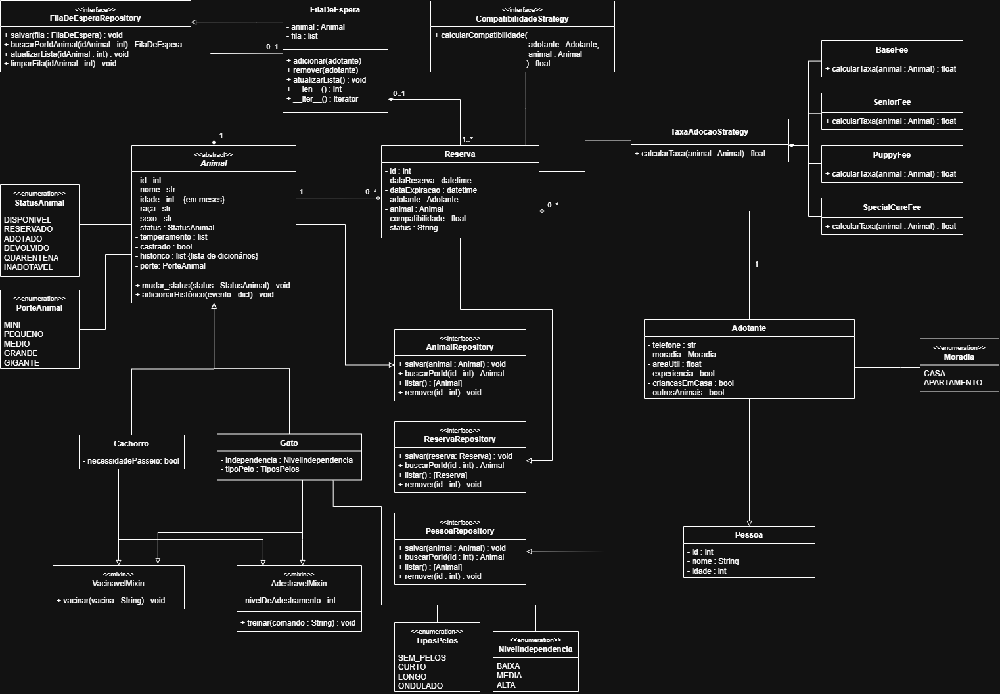

<h1 align="center">Sistema de Adoção de Animais</h1>
<p align="center">Projeto voltado a criação de um sistema de adoção de animais para gerenciar o cadastro de animais, triagem de adotantes, reservas, adoções, devoluções, quarentena e relatórios.</p>
<p align="center">Esse é um projeto da disciplina de <strong>Programação Orientada a Objetos</strong> do curso de <strong>Engenharia de Software</strong> na <strong>Universidade Federal do Cariri (UFCA)</strong></p>

<div align="center">
    <a href="https://www.ufca.edu.br/cursos/graduacao/engenharia-de-software/">
    
    </a>
</div>

---
<br>

## Diagrama de Classes UML


---
<br>

## [Diagrama de Classes textual](docs/DiagramaDeClassesTextual.md)

## Estrutura de arquivos atual:
```
│   .gitignore
│   main.py
│   README.md
│
├───database
├───docs
│       DiagramaDeClasses.drawio
│       DiagramaDeClasses.png
│       DiagramaDeClassesTextual.md
│
├───src
│   ├───domain
│   │       adotante.py
│   │       animal.py
│   │       cachorro.py
│   │       fila_espera.py
│   │       gato.py
│   │       pessoa.py
│   │       reserva.py
│   │       __init__.py
│   │
│   ├───enums
│   │       status_animal.py
│   │
│   ├───exceptions
│   ├───mixins
│   │       adestravel_mixin.py
│   │       vacinavel_mixin.py
│   │
│   ├───repositories
│   │       animal_repository.py
│   │       fila_de_espera_repository.py
│   │       pessoa_repository.py
│   │       reserva_repository.py
│   │
│   └───strategies
│           compatibilidade_strategy.py
│           taxa_adocao_strategy.py
│
└───tests
```

## CLI de animais (Typer + Rich)

A CLI permite cadastrar e administrar cachorros e gatos, consultar animais e manter o histórico.
Execute na raiz do repositório:

```bash
python main.py --help
python main.py animal --help
python main.py animal cachorro cadastrar --help
```

Exemplos:

```bash
python main.py animal cachorro cadastrar "Rex" 24 "Labrador" M 18 GRANDE --castrado --temperamento "calmo,brincalhao"
python main.py animal gato cadastrar "Mimi" 12 "SRD" F 4 PEQUENO MEDIA CURTO
python main.py animal listar --status DISPONIVEL --idade-max 36
python main.py animal ver 1
python main.py animal vacinar 1 "Antirrábica"
python main.py animal historico 1
python main.py animal mudar-status 1 RESERVADO
```

As datas usam `AAAA-MM-DD`. O banco SQLite fica em `src/sistema_de_adocao_de_animais/database/database.db`.
Os comandos de alteração confirmam o sucesso em um painel Rich; erros de validação são exibidos sem traceback.

## CLI de adotantes (Typer + Rich)

O grupo `adotante` permite cadastrar, consultar, atualizar e excluir adotantes, além de avaliar elegibilidade e compatibilidade com um animal. Consulte os comandos disponíveis:

```bash
python main.py adotante --help
python main.py adotante cadastrar --help
python main.py adotante atualizar --help
```

Exemplos:

```bash
python main.py adotante cadastrar "Maria Silva" 30 88999999999 CASA 80 --experiencia --criancas-em-casa
python main.py adotante listar
python main.py adotante ver 1
python main.py adotante atualizar 1 --area-util 100 --sem-criancas
python main.py adotante elegivel 1 1
python main.py adotante compatibilidade 1 1
python main.py adotante excluir 1
python main.py adotante excluir 1 --sim
```

O telefone deve conter 11 dígitos numéricos (DDD + número). A elegibilidade usa as políticas de `settings.json`; a compatibilidade apresenta a pontuação de 0 a 100 e as notas dos critérios ponderados. As listagens e os resultados são estilizados com Rich.
